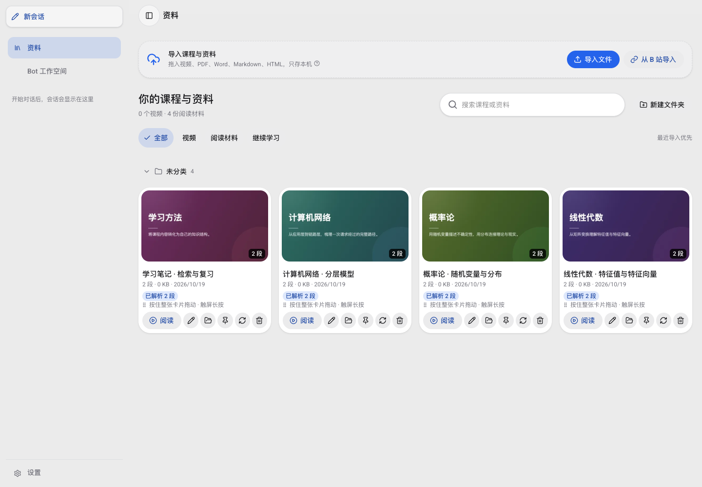
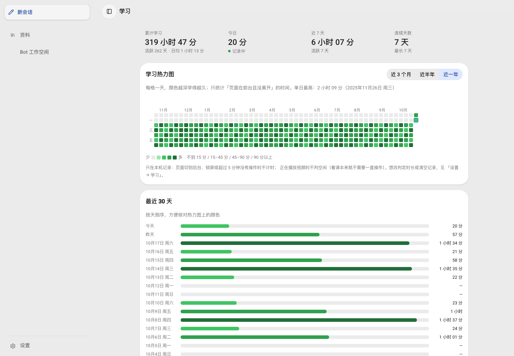

# DeepStudent Go

一个自部署的学习工具。把课程视频、PDF、Word、Markdown 和 HTML 放在一起，看课、读资料，再围绕这些内容提问、整理讲义和制作复习卡片。

比如，导入一节课，生成字幕后问「这一步为什么成立」，从回答的时间戳跳回原处；或者把整章整理成 Markdown 讲义，自己接着改。它也提供普通聊天和能在授权文件夹里处理文件的 Bot。

[安装](#安装) · [怎么用](#怎么用) · [数据与隐私](#数据与隐私) · [本地开发](#本地开发) · [文档](#文档)

## 能做什么

- **看课和读资料**：视频倍速、字幕跳转、断点续播；PDF、Word、Markdown、HTML 阅读，支持划词、框选提问和手写批注。Markdown 可以直接编辑。
- **转写字幕**：抽取音频、分段转写，完成一段显示一段，可导出 SRT / VTT。B 站视频有自带字幕时可以直接使用。
- **结合原文问答**：检索字幕和文档正文，回答保留时间戳、页码或段落引用。可以指定课程，也可以跨课程查找。
- **整理与复习**：在对话中生成讲义，保存为资料库里的 Markdown 文件；生成练习题、思考题弹幕、AI 讨论串，以及审核后可导出为 Anki `.apkg` 的卡片。讨论串是模型生成的，不是真实用户评论。
- **让 Bot 处理文件**：给 Bot 授权一个资源文件夹，在多条会话里共用文件。命令执行使用独立 Docker 沙盒，默认需要审批，默认可联网，可在「设置 → Bot → 权限 → 命令可联网」关闭。
- **接自己的模型和工具**：支持 OpenAI Chat、Responses、Anthropic Messages 协议，可配置转写、文本和视觉模型，导入技能或接入 MCP。

网页适配桌面和手机、平板，支持中英文。通过 HTTPS 或 localhost 访问时，可以安装为 PWA。PWA 会缓存应用外壳和部分资源，不意味着所有课程、模型功能都能离线使用。

### 界面

课程库：



学习记录：



截图使用演示资料和模拟记录，部分界面可能与当前版本不同。

## 安装

推荐部署在自己的 Linux 服务器上，一套部署供一个管理员使用，再从其他设备登录。前端、API 和反向代理分开运行，数据保存在服务器。

需要 Docker Engine、Docker Compose 插件和 OpenSSL。使用模型功能还需要自行准备模型服务及 API Key；项目不提供免费额度。

### 从源码安装

当前仓库没有提供可直接拉取的官方 API / Web 镜像，首次尝试请显式使用源码构建：

```bash
git clone https://github.com/BA7MLV/wangke-agent.git deepstudent-go
cd deepstudent-go
./install.sh --build-from-source
```

服务默认监听 `3000` 端口。安装完成后，终端会打印一次性 Setup URL。打开完整链接，创建管理员、设置密码，再按页面提示配置模型。链接含初始化密钥，请不要分享；默认 24 小时过期，创建管理员后失效。

项目已更名，但仓库地址暂未变更。安装目录 `~/.wangke-agent`、管理命令 `wangke-agent`、`WANGKE_*` 环境变量、内部包名和数据库名也保留旧标识，以兼容已有安装，无需手动改名或搬数据。

### 公网访问

先把域名解析到服务器，开放 80 / 443 端口，再运行：

```bash
./install.sh --build-from-source --domain learn.example.com
```

脚本会配置 Caddy 自动申请证书。已有 HTTPS 反向代理时，改用 `--public-url https://learn.example.com`，并自行配置代理转发、上传大小和超时。Passkey 需要 HTTPS 域名或 localhost，注册后应保持域名不变。

### 启用命令沙盒

需要 Bot 执行命令时，安装时加上 `--agent`：

```bash
./install.sh --build-from-source --agent
```

沙盒工作区持久保存，Bot 可在服务端多步执行、等待用户审批或按时间继续任务。关闭网页不会停止后端 Bot。不要把沙盒 broker 暴露到公网，也不要给不可信任务开放网络权限。

### 使用已有镜像

如果你已经自行构建并发布了镜像，可先生成配置，再填写安装目录 `.env` 中的 `WANGKE_API_IMAGE` 和 `WANGKE_WEB_IMAGE`，最后启动：

```bash
./install.sh --no-start
# 编辑 ~/.wangke-agent/.env，填写可访问的镜像地址，生产环境建议固定 digest
./install.sh
```

不带 `--build-from-source` 的安装默认拉取镜像，不会自动替你构建。当前发布流程做过限定范围的隔离 Linux 测试，但不代表任意生产环境都已验证；已有实例升级前请先备份并阅读[部署说明](docs/deployment.md)。不要让两个 API 实例同时访问同一个 SQLite 数据库。

## 怎么用

### 读资料、问课程

1. 在「资源」中新建文件夹，上传视频或文档。支持 PDF、`.docx`、`.md` / `.markdown`、`.html` / `.htm`；旧版 `.doc` 需要先另存为 `.docx`。视频能否播放取决于浏览器支持的容器与编码。
2. 打开视频，在学习助手的「字幕」面板生成字幕；文档则等待正文解析完成。纯扫描 PDF 没有文本层，需要先做 OCR，或将相关页面作为图片提问。
3. 在课程问答里直接提问，也可以选中文字、截取视频画面或框选 PDF 区域。点击回答里的引用回到来源，核对模型有没有理解错。
4. 想整理笔记，在问答输入框的加号菜单选择「生成讲义」。讲义保存为 Markdown 资料，后续可以续写或手动修改；聊天里的内容只是当时的快照，文件才是最新版。

转写、PDF / HTML 解析等部分任务仍需要浏览器 Worker。服务器不会自动启动 Chromium；需要时，在已登录的 HTTPS 页面打开 `https://你的域名/?cloud-worker=1` 并保持该页面运行。没有 Worker 时，这类任务会留在队列中。普通聊天、课程问答和 Bot 的后端任务不依赖这个页面。任务分工见[任务执行说明](docs/task-execution.md)。

课程检索使用 BM25 全文匹配，不需要额外的向量模型。它依赖原文用词，换一种说法可能搜不到；可以补充术语、章节名或原句再问。引用有助于核对，但不能保证回答正确。

### 使用 Bot

在「资源」的文件夹设置里授权 Bot，再从「BOT 聊天」创建会话。文件夹中的原文件与 Bot 的工作区是同一份文件，不需要来回复制。

读取、写入、删除、执行命令和联网受授权及审批策略约束。只读授权不能执行命令；开启沙盒也不会自动开放网络。资源文件夹会话暂不继承账号级 MCP 连接器，独立 Bot 会话可以使用它们。具体边界见[资源文件夹与 Bot 工作区](docs/project-workspaces.md)。

### 导入 B 站视频

桌面浏览器优先使用 [Tampermonkey 导入桥](userscript/README.md)，从本机请求 B 站；没有油猴环境时，可以自行部署[代理 Worker](cloudflare-worker/README.md)。导入能力受平台接口、账号权限和网络影响，不绕过会员或付费限制。

手机和平板 PWA 不能安装这支油猴脚本，可以先在电脑导入，再登录同一服务器查看，也可以直接上传本地文件。

## 数据与隐私

**自部署不等于完全离线。** 服务器保存数据，但使用远程模型时，相关问题、检索片段、图片或音频仍会发送给你配置的模型服务。使用前请确认它的数据处理政策。

- **服务端部署**：数据库默认位于 `/data/db/wangke.sqlite`，原文件与工作区位于 `/data/files`，加密配置所需密钥位于 `/data/config/credentials.key`。使用安装脚本时，它们对应安装目录下的 `data/`。
- **模型凭据**：通过网页保存后加密存于服务器，读取接口不返回明文。旧的 `MODEL_*` 环境变量仍可提供初始配置，请同时保护安装目录的 `.env`。
- **浏览器缓存**：服务端模式下，IndexedDB 是按账号隔离的缓存；纯静态模式没有服务器，资料保存在当前浏览器的 IndexedDB / OPFS 中，清理站点数据可能丢失。
- **HTML 材料**：「原样」视图默认会加载文档引用的远程图片、样式和字体，第三方会收到请求。可以在设置中关闭外部资源；导入文档的脚本不会执行。
- **实时链路**：是需要主机页面在线的只读镜像，不是云备份。使用前需自行部署中继，见 [Worker 说明](cloudflare-worker/README.md)。

### 管理与备份

默认安装的管理命令：

```bash
~/.wangke-agent/bin/wangke-agent status
~/.wangke-agent/bin/wangke-agent logs -f
~/.wangke-agent/bin/wangke-agent restart
~/.wangke-agent/bin/wangke-agent backup
```

备份需要一起保存数据库、原文件、配置密钥和 `.env`，并放到另一台机器或离机存储。缺少 `credentials.key` 无法解密已保存的模型配置。不要删除数据卷来解决更新问题。

旧独立 Bot 会话使用的 `wangke-workspace-*` Docker volumes **不包含在应用备份里**，需要另行备份；资源工作区里若有符号链接、依赖目录等，也需按[运行时文档](docs/agent-runtime.md)选择文件系统备份方式。更新、回退和恢复操作见[部署说明](docs/deployment.md)与[个人云端说明](docs/personal-cloud.md)。

## 本地开发

需要 Node.js 22.6+，仓库使用 npm workspaces 和 Turborepo。

```bash
npm ci
npm run dev
```

默认前端地址为 `http://localhost:5173`，未配置 API 代理时使用浏览器本地存储。完整后端、Bot 和沙盒需要单独启动对应服务。

联调 API 时，分两个终端运行：

```bash
# 终端一：本地 API，启动前需导出所需环境变量，不会自动读取 .env
PUBLIC_ORIGIN=http://localhost:5173 npm run dev:api
```

```bash
# 终端二：前端连接 API
WANGKE_API_PROXY=http://127.0.0.1:3000 npm run dev
```

本地视频封面任务需要系统 FFmpeg，或通过 `FFMPEG_PATH` 指定可执行文件。直接启动 API 不会托管前端页面。

### 构建与测试

```bash
npm run build        # 检查边界、类型并构建全部工作区
npm run build:web    # 只构建 Web 及共享依赖
npm run build:api    # 只构建 API 及共享依赖
npm run check:i18n

npm run test:api
npm run test:bot
npm run test:resources
npm run test:install
```

前端与 API 产物分别在 `apps/web/dist`、`apps/api/dist`。更多专项测试在 `package.json` 和 `scripts/`；浏览器测试的服务、凭据与超时要求见 `scripts/e2e-all.mjs` 的 `META`：

```bash
node scripts/e2e-all.mjs
node scripts/e2e-all.mjs --only=e2e-import,e2e-mobile
```

预览类测试使用构建产物，修改源码后要先重新构建；已有 preview 服务也需要重启。涉及真实模型的测试需要额外凭据，会产生 API 费用，不能用无 Key 测试通过来代替实际验证。

### 代码位置

```text
apps/web/             React 网页、播放器、阅读器、PWA
apps/api/             Fastify API、鉴权、存储、任务与 Bot
apps/ios/             iOS 壳层
apps/apple/           Apple 客户端共用的 Swift 包
packages/contracts/   前后端共享契约
packages/study-core/  模型客户端、检索、生成等共享逻辑
infra/                反向代理、Docker 沙盒与 broker
scripts/              构建、管理、备份与测试脚本
userscript/           B 站导入桥
cloudflare-worker/    B 站代理与实时链路中继
docs/                 部署说明、设计与验收记录
```

前端使用 React 19、Vite、TypeScript、HeroUI v3 和 Tailwind CSS 4；后端使用 Fastify 与 SQLite。新功能先在 `docs/plans/` 写明目标、边界和验证方式。UI 沿用现有主题令牌与 `apps/web/src/ui/` 公共组件，图标通过统一的 Tabler Icons 适配层使用。

## 文档

- [部署、发布与回退](docs/deployment.md)
- [账号、数据与恢复](docs/personal-cloud.md)
- [资源文件夹与 Bot 工作区](docs/project-workspaces.md)
- [Bot 运行时与沙盒](docs/agent-runtime.md)
- [任务执行与浏览器 Worker](docs/task-execution.md)
- [MCP 接入](docs/mcp.md)
- [IM 网关](docs/im-gateway.md)
- [iOS 客户端](apps/ios/README.md)

## 使用范围与许可

请只导入有权使用的材料，遵守内容平台的协议和所在地法律。项目不提供课程内容，不支持绕过访问权限或未经授权的批量抓取、传播。模型输出可能有误，学习和使用时请核对原文；模型调用费用由使用者承担。软件按现状提供，不附带担保。

原创部分保留 [MIT 声明](LICENSE)。聊天删除动画包含 Telegram Android 的 GPL-2.0 源码移植，组合应用对外分发须满足 GPL-2.0 要求，包括提供完整对应源码与构建脚本。详见[来源及许可说明](apps/web/src/third-party/telegram-thanos/NOTICE.md)和[完整 GPL 文本](apps/web/public/licenses/telegram-thanos-GPL-2.0.txt)。上述许可不覆盖第三方课程内容、模型权重或平台数据。
